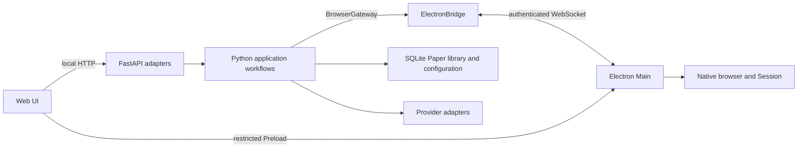

# Architecture

Allfold is one desktop product: an Electron host, a Python application and a Web UI. Electron owns startup and shutdown; Python is not an independently supported Web service.

## Runtime data flow

Main starts one Python process. The HTTP origin remains loopback-only on port 18767; one authenticated WebSocket carries native operations, progress and Solver submessages. Remote pages have no Node or host IPC capabilities.

## Ownership

| Source | Responsibility |
| --- | --- |
| `frontend/ui/` | Workspace, Workflows, Journals and Settings UI, source assets and notices |
| `src/allfold/application/` | Use cases, guarded operations and process-local workflow coordination |
| `src/allfold/providers/` | Provider retrieval, queries and source-specific formats |
| `src/allfold/persistence/` | Production SQLite Paper library and projections, safe file operations, Registry and local state |
| `src/allfold/integrations/` | Credential and Pydoll adapters |
| `src/allfold/web/` | HTTP projection, validation, composition and Electron WebSocket transport |
| `src/allfold/http_client.py` | Shared synchronous Python HTTP client, proxy parsing, bypass rules and per-request transport routing; independent of Chromium Session |
| `electron/src/main.cjs` | Application lifecycle, trusted IPC and native dispatch |
| `electron/src/browser/` | Native pages, main-window presentation, document identity, navigation and shared Session |
| `electron/src/auth/` | Task-scoped institution authentication and credentials |
| `electron/src/workflows/` | Login, Service preparation, Covers and WoS native page operations |
| `electron/src/preload/`, `native-ui/` | Restricted capabilities and local native-window UI |

Models, configuration definitions, identifiers and query primitives remain shared Python modules. Application code does not depend on Web adapters; its BrowserGateway exposes connected/execute and exact cancel_workflow/cancel_task interfaces. ElectronBridge adapts it to transport. Each Request ID owns its operation context, progress, cancellation and Solver replies, page claims and terminal result. BrowserTaskLock admits explicit shared saved-Service data use while keeping overlapping controls and exact physical Page claims exclusive. Login, Covers and WoS each retain one active coordinator state; Browser admission is separate from the Workspace collection registry. Native operations settle before their Futures release ownership. WoS keeps its captured workflow/task loan across Query→Export gaps; a finally-issued release_workflow_pages maintenance request releases that same loan only after native settlement, including cancellation and input loss. Shutdown stops admission and drains Run, Preprint, WoS, Login, Covers and the Workspace host before closing common client resources.

Journal lookup and remote fallback belong to the application layer; persistence only reads the local Registry. WoS export parsing continues to reuse safe file-reading helpers.

FastAPI composes these implementations. Workspace UUIDs and captured Paper eligibility belong to the application; HTTP accepts UUIDs and Workspace identity rather than arbitrary paths. Provider normalization uses shared identifiers rather than application workflow helpers.

## Browser Service associations

Python snapshots saved Journals and Access Services for each invocation. The bridge
carries canonical configuration scope, configuration revision and User State
revision alongside the saved Service ID. ISSN/eISSN matching assigns complete
Papers to Journals and Services; source names do not confer membership. These
snapshots are descriptive, not a second mapping authority. Prepare verifies the
captured institution, credential epoch and selected saved Service records; unrelated
configuration/User State revisions do not renew or revoke that authority. WoS
retains its stricter foreground Run input snapshot and Query→Export binding.

Login runs one CARSI institution flow. Each subsequent CARSI preparation opens its own resource Portal in the same Session. The saved Access Service ID and observed source and target pages establish provenance. Manual Services use explicit visits. Login keeps outcomes and target Page IDs in memory, bound to the saved Service and institution authority. After a settled batch with Services that need attention, one user confirmation marks the batch's unchanged saved Services available. Existing prepared targets are retained. Ordinary settings edits preserve a prepared target while the next task takes a fresh configuration and User State revision. Discover uses the prepared WoS target or opens the official query page in the shared Session after manual confirmation. Query and Export still validate the scoped Service, document and export path. API discovery remains independent of that prerequisite.

Browser Runtime uses one business Session from `session.fromPartition('allfold')`.
Selection and presentation are separate from task ownership. Prepare, WoS, Login
and Covers retain their scoped Page/Document checks, cancellation and manual
verification. DocumentRuntime and its isolated preload supply bounded
binding/access/article/extract/pdf observations, never full HTML. Native Document
binding, independent Paper identity and task/Service authority are separate.
The internal Paper extraction operation checks access and current article identity,
reads Date/Abstract and independent PDF clues, then rechecks the same live Document before normal
page cleanup. Its small verified result can be committed after that cleanup;
Python rechecks the captured Workspace/Paper/attempt, not the closed page.
The Cloudflare adapter remains request/CDP-target scoped. See
[controlled Documents](browser-documents.md) for the runtime contract.

WF07 separates a pure qualified-rule service, small exact-target discovery facts,
and a result-driven P1–P5 coordinator. The core consumes immutable target/facts
and task-scoped guard/cancel/deadline capabilities. It owns neither collection
registration nor metadata/body writes. Current Run and necessary API responses
project reusable OpenAlex/Crossref facts before lossy bibliography normalization;
the existing records/increment path persists them in short SQLite transactions.
Same-Document precollection never follows a PDF candidate. PDF-only refresh and
known-reader parsing reuse native access, physical quotas and cleanup. Subsequent
Download can use the core after collection completes without restarting that
collection. WF08 installs production collection orchestration; WF09/10
transfer/files remain separate. The [adopted specification and fixed source catalogue](pdf-source-discovery.md)
retain all platform/input/access conditions and historical exclusions.
The immutable discovery target includes the saved direct-identity closure, so
complete DOI-free Work facts can be reused without a new lookup or native
article read. Conditional OCE reading obtains only an operation-local boolean
from the captured prepared target, then rechecks the same context at use; it
does not derive OCE access from an LWW Service or change Prepare.

Keep/Import/Enrich have no product HTTP/IPC or native dispatch path. Dedicated
Zotero Local API, attachment writes and full Translator assembly are removed;
Setup no longer downloads or assembles translation-only sources. Existing ignored
vendor checkouts are untouched. [Third-party notices](third-party.md) retain
attribution for remaining adapted Document/Browser sources.

A managed main-frame load has an 85-second window and at most two refreshes.
The refresh delays are 350 and 700 ms, each multiplied by a random factor from
0.75 to 1.25. During CARSI Prepare, the target page shares that refresh budget
across redirects and subsequent main-frame GET navigations. A transient target
load failure after two refreshes can start one new Visit from the CARSI resource,
even if the second refresh completed and a later navigation failed. This path
does not resend the failed request. An eligible page-load timeout can also
trigger reentry. An eligible initial Paper load can similarly replace its page
once. The new page gets its own loading
window within the original 10-minute native loading or Prepare deadline and a
three-minute cap from the start of business recovery.

The Browser Session shares active cooldowns by HTTP origin. The existing
WebRequest listeners observe main-frame and explicitly associated request 429 responses and 503 responses with a
valid Retry-After. The default for a 429 without usable Retry-After is one second.
An active cooldown can only extend. Allfold-initiated navigations and refreshes
wait up to 30 seconds within their operation budget. Visit also checks the
publisher origin when it is known from the saved entry or a prior attributable
Visit. Chromium continues its redirects, authentication chain and page requests.

[One Session event owner](browser-session.md) now installs the native hooks for
BrowserRuntime, identity and WoS. Scoped handlers compose synchronously; task
cleanup leaves the common entry and cooldown live. Controlled cover fetches use
request-ID association, stripped private markers and the same origin gate.
Downloads retain native source/frame/Document ownership and actual terminal
promises rather than replaying captured URLs. Fixed Electron 45 fixtures record
the supported original-response entries and source-lifetime limits there.

## History and diagnostics

Python coordinators publish bounded business history independently of their
Workspace result snapshots. The unified Run exposes selected-source counts, statistics, issues and retrieval observations through `RunFacts`; its Integrated snapshot uses v6. Old Integrated v4/v5 reads return unsupported and require a new Run, without migration or Reset. Legacy WoS snapshots remain untouched and are not reconstructed into unified results. Electron and Python write separately owned, rotating
JSONL under a common configuration scope and startup runtime ID. Explicit workflow,
task and request identities link native observations with coordinator-confirmed
results. Page association snapshots are descriptive evidence, never browser or
credential authority. A versioned data-only schema validates producer events and
independently filters exports; neither arbitrary log messages nor raw exceptions
enter this store.

The Web adapter exposes recent history, local diagnostic ZIP export and guarded
Logs Reset. Reset coordinates the native writer, preserves existing Workspace
safety checks and marks surviving history when Workspace is reset. See
[logging](logging.md) for storage limits, field meanings and evidence boundaries.

`bindTaskPage` and explicit `navigate(..., {tab})` control task targets. `select` presents a page in the main-window Browser pane; task navigation and WoS handoff do not select tabs. Background creation does not select even the first page, open Browser or focus a webpage. Task pages remain available for explicit manual login or inspection until their owner finishes; only explicit bounded access contexts survive completion. Service associations confer no document, task or institution-credential authority. Page/frame identity, task signals, navigation recovery and native-save settlement remain separate checks.

## Configuration editing

One configuration controller owns the saved revisions and ordinary drafts across
Workflows, Journals and Settings. A shared scheduler serializes safe field patches;
responses acknowledge the submitted snapshot without replacing later edits.
Server-side admission coordinates writes with task starts, retaining the existing
Compare-and-Write and Workspace lock protections. Active tasks continue using
their captured inputs. Foreground Run/WoS and Preprint snapshot writers keep ordinary
edits Pending until settlement; independent Browser owners allow unrelated input,
Journal and Service edits. A change overlapping an executing Service waits for its
owner to settle. Saved access changes invalidate captured old preparation/authentication
keys and await their scoped native cleanup outside the configuration write lock.
An access-cleanup owner prevents conflicting Prepare/control admission until actual
cleanup; captured old keys cannot revoke a later context. Actual retained-Page
destruction also invalidates the matching Python preparation, including late results. A new task requires successful
save and validation; a failed or conflicting draft cannot become task authority.
Provider secrets, CARSI credentials and high-impact operations use explicit
submission rather than ordinary autosave. CARSI mutations settle through the
authenticated native bridge and compare encrypted-store revisions. Credential
controls hold exclusive admission through native settlement, without holding the
configuration write lock across the bridge wait. Covers commits under the short
configuration/asset guards and compares its target Journal, asset-tree identity and
exact target cover record/image, preserving unrelated edits while refusing replaced
Journal or cover assets.

## Workbench and task presentation

The main Window contains Chrome, a flexible Workbench Content region and Status.
Its business workspaces are Workspace, Workflows, Journals and Settings.
Workflows keeps Login and Discover under one navigation entry.
Browser, Search and History are shared header tools. Quick Open reads the current
local Paper, Journal, saved Service and native tab projections, dispatching each
selection to its owning controller. A `>` prefix searches the command registry.
Browser fills Workbench Content while the business surface retains its state.
The address toolbar and left navigation rail occupy trusted DOM space outside
the native webpage rectangle.

ARRAY, Workflows, Journals and Settings share a presentation-only Navigation Rail,
overlay Index/Directory flyout, Content and Functional Sidebar/Tool Rail. Their
mounted hosts retain expansion and compute docked/overlay geometry from actual
container bounds; targets and measured widths stay separate. Business Controllers
own selection, drafts and shared Reader lifecycle. See [workspace layout](workspace-layout.md)
for size constraints, preference behavior and acceptance boundaries.

BrowserRuntime owns physical pages, task associations and their shared Session. Browser Presentation owns attaching, showing, hiding, sizing and explicitly focusing a selected WebContentsView on the main window. The trusted renderer reports its measured webpage body in CSS pixels through a restricted, sequenced IPC. Main converts with the host's actual Zoom Factor to Electron logical pixels, independently of display DPR, and validates sender, main frame, command, Page ID and rectangle against the host content bounds. Hiding Browser or suspending it for a trusted dialog does not destroy pages or cancel operations. Fullscreen task surfaces can be suspended for explicit Browser interaction and resumed without restarting their player or changing task state.

One Tabs flyout groups Page IDs under CARSI, a scoped saved Service, or Other.
A Service group is keyed by scope ID and saved Service ID; saved names supply
labels. Unassigned and shared pages use explicit roles and recorded provenance.
The directory uses the shared layout controller for flyout size, focus and scroll.
Grouping grants no task, document or authentication authority.

Archive availability and fullscreen task presentation are local UI preferences, outside YAML Save and business SQLite. Archive defaults disabled while its existing resources and layout preference remain available. Legacy Paper links resolve against the current ARRAY Candidate/Downloaded/Trash projection or report a missing Paper. Login, Discover and Preprint keep their existing coordinators. Discover captures its display preference at start. Login retains their progress and controls in Workflows independently of Browser visibility.

## Resources and third-party code

The UI build copies sources into Python's ignored static delivery tree. Served UI URLs and API endpoints do not depend on the editable source directory.

Electron package metadata and scripts remain at the package root. `src/shared/paths.cjs` resolves project, native UI, Preload and native UI locations. Existing official vendor checkouts stay pristine in ignored directories. They are
not setup/build inputs after translation-only Runtime retirement. See
[third-party sources](third-party.md).

## Data ownership

Local YAML owns monitor settings. The private `.allfold/user-data.sqlite` owns Journals, Groups, Labels, direct Access Services and default Service assignments, isolated by the canonical configuration path. Existing valid `list.md` files seed each configuration once; subsequent Markdown edits do not change saved user state. Migration validates the complete managed data, records its source and digest, and leaves the original file intact. The production [SQLite Paper library](paper-library.md) owns stable UUID/direct
identities, explicit primary identity, metadata, exclusions and one optional body
association at `Workspace/papers.sqlite`. HTTP handlers and workers open separate
thread-confined connections. Read-only uninitialized views create nothing; Run
performs explicit initialization. Paper storage supports only its current schema; corruption and
unknown schemas fail without replacement. Current-attempt and branch facts are bounded. No data-upgrade path or Markdown shadow/fallback exists.

Workspace UI uses separate library revisions for response order. WriteToken
remains captured asynchronous eligibility, with separate abstract generation.
Reject persists exclusion before exact-Paper cancellation outside write locks;
restoration cannot revive old work. Clearing metadata waits for actual cleanup.
See [identity](paper-identity.md) and [task boundaries](workflow-refactor-tasks.md).

The private `.allfold/resources.sqlite` shares complete GOKB snapshots and the CARSI official Catalog across configurations. It holds external evidence, not users' Service preferences. Refresh commits only validated, complete data and retains the previous cache on failure. The Journal Resolver follows Journal → GOKB Platform → CARSI Resource, retaining multiple identities and products. Only a unique, reliable candidate can fill an empty default; saved user choices take precedence. Ordinary Run never requires GOKB.

The two application-level databases live outside Workspace; the independent Paper library belongs to its Workspace. Within the application project, configurations in subdirectories use the same application data directory; their canonical paths still identify separate user scopes. Registry remains read-only during normal use and retains source-specific evidence. Browser handles and scheduler queues remain transient; current collection qualification and branch completion belong to Paper SQLite. Generated UI is rebuildable, not user data.

[Safety](safety.md) states the cross-module invariants. Types, parsers and validators in code define fields and interfaces; [development](development.md) defines preparation and verification. Historical plans and investigations are not current implementation authority.

## Foreground Run and Paper collection

The Python application process owns Provider cooldowns across clients, keyed by
actual HTTP origin and authentication context. Short-lived clients retain active
cooldowns until they expire or the process exits. Application-owned pacing is
injected into current Run, manual Preprint and independent attempt clients;
request/response caches and mutable client state remain operation-local.

Provider adapters emit operation-local `ProviderWorkEvidence`; canonicalization groups
explicit strong identities and selects missing metadata in a fixed order.
One Integrated Run overlaps selected PubMed/WoS/OpenAlex journal Discovery under the parent slot and workflow identity. PubMed batches ESearch History/EFetch; OpenAlex merges native source-ISSN filters. Verified pages/native export batches stream DOI targets to shared exact Work lookup. Provider clients share operation-local capability caches, in-flight full Work details and host pacing. A bounded producer/consumer queue coalesces DOI inputs while sources remain active, then drains the final short batch after every producer settles. Work lookup responses enrich discovered roots and never add Discovery candidates. Formal PubMed identity remains separate from a merged Work’s potentially preprint PMID. The Browser worker retains the same captured configuration/Workspace/cancellation authority and never writes a separate Run snapshot or History result.

After Discovery and Work lookup settle, Run deduplicates and excludes saved Papers
including Rejected. Necessary batched PubMed article-ID lookup confirms missing
direct formal PMIDs before first creation. Original responses retain qualifying
formal bibliography, dates, abstracts and source facts. Ordinary missing fields
never schedule a generic Completion request. Retained client/lookup/batch/binding
helpers live in `application/provider_lookup.py`.
Native publication-date filters determine its range; subsequent evidence never
rejudges inclusion. Commit rechecks captured configuration, source revision,
Workspace/database identity and the complete identity index before atomic creates.
Existing full matches preserve their metadata and acquire any new verified direct
aliases. Excluded matches stop avoidable follow-up
work; a cleared unexcluded placeholder can be rebuilt only from a real Run hit,
using its existing UUID. Final short transactions recheck identity conflicts and
captured Workspace/database eligibility. Run snapshots/logs use repository UUIDs,
not temporary Provider IDs or Markdown paths. `ProductionCollectionService`
composes the entire stable `document` and `necessary-api` plan. Registry admission
atomically creates/matches base metadata and queued qualification with original
tokens; registration runs outside the Run commit boundary. A matched complete
`not_started` Paper is admitted on this actual hit, independently of unknown-only
helper suppression. Active work is reused, normal completion never reopens, and
failed/cancelled work requires explicit retry.

Run finishes after all base results are registered or explicitly failed and its
own queries/native Futures/clients/snapshot have ended. Workspace owns transferred
tasks and cancellation independently, allowing another foreground Run. Source Run
IDs are diagnostic labels; cancelling Run B does not cancel A or Papers already
handed over by B. History/Last Run describe only foreground retrieval, identity,
created/matched/excluded and admission outcomes; background writes do not change
those results or their completion time.

WF06's internal necessary-query service has a separate request planner. Ordinary
abstract, author and event-date gaps do not create requests. It consumes verified
capability-labelled facts, resolves explicit identity/Preprint relationships and
queries known native version families with execution-owned clients. Formal
increments and independent Preprint proof are separate; a new `first_public_at`
is offered only after all applicable relationship/native work and every known
family settle successfully. Production plans explicitly declare Providers,
records, complete/partial capability facts and required purposes. They transfer
immutable evidence, never Run clients/caches or replay callbacks. Base metadata
cannot seal partial native proof; truly complete foreground proof may be reused.

The Info Preprint coordinator tracks independent Workspace/Paper/request
operations and verifies native bioRxiv/medRxiv publication and version responses.
It uses the registry's bounded scheduler and original Paper reservation/token,
without a Run slot or full Run input snapshot. Network work holds no write lock.
The guarded commit checks metadata/operation and narrow Provider eligibility
before merging proof. Explicit repeat queries do not modify completed collection
facts. A first collection intent can wait behind an already accepted query;
actual client/repository/owner cleanup makes it ready. New manual clicks do not
queue behind other work on the same Paper.

Ordinary dates are independent normalized month/day sets. Bibliographic
publication date retains its explicit source. Preprint evidence preserves version
families, verified first-version proof and unresolved relations; it never becomes
a formal direct identity or an ordinary date solely through association. Reader
and Info display these new library projections without old event/source columns
or active Enrich buttons. WF05 provides internal background scheduling. WF06 adds
internal Date/Abstract and purpose-driven API/Preprint services through those task
interfaces. WF08 uses both branches in production. WF07 supplies PDF clues/source
discovery; transfer, permanent files and public Download remain WF09/WF10.

## Workspace collection runtime

FastAPI composes one `WorkspaceTaskHost`, its shared Provider pacing/factory and
the current Workspace registry. Workspace switching/Reset first reserves admission,
revokes the old lifecycle and drains outside short configuration/Paper/SQLite
locks, then revalidates the save/deletion target. Ordinary input edits do not stop
independent collection; sensitive access changes drain only affected scopes.
Application shutdown joins owned work before closing the common factory, while
the authenticated bridge continues to deliver native resource terminal results.

WF05 adds a Workspace-owned `WorkspaceRegistry`, with an immutable Workspace UUID,
path/inode identity and lifecycle ID. Reliable identity create/match/rebuild and
queued collection admission commit together before registration. Its dynamic
round-robin scheduler admits later Papers and Services and survives idle periods.
The internal defaults bound executing Paper jobs to four globally and two per
trusted Service; API/public work uses one `None` group. These task counts include
client/native/write cleanup and are separate from physical page capacity.

One Paper gate arbitrates collection, controlled download reservations, explicit
Preprint reservations and metadata clearing. Durable queued/running eligibility
also blocks Download during the admit/register window. Branch increments use the
original WriteToken, lifecycle, attempt, branch and sequence; duplicate delivery
cannot reapply a cleared abstract. Completion follows actual worker/client/native
settlement. Explicit retry preserves same-generation successful branch facts.
Terminal persistence/cleanup faults retain conservative runtime occupancy.

Each leaf branch runs on a separate bounded scheduler and opens its own repository
and independent client context, allowing same-Paper Document/API overlap without
parent/child pool starvation. Declared
Providers scope credentials and mutable clients/caches; shared pacing outlives
those contexts. Narrow access authority captures the actual saved Service,
Prepare binding and selected credentials. Source Run IDs are diagnostic only.
Lifecycle initialization marks prior queued/running work interrupted/failed once,
without queue replay or network. Host-visible ownership and original branch epochs
cover the base-commit/register window before external authority initialization.
Failed access/startup preserves base metadata and independent branch results.
Branch-local access changes drain only affected work; Workspace/Reject revocation
still ends the whole Paper. Explicit Retry checks only unfinished dependencies
and retains successful branch facts. Public Retry is available; Download and body
operations remain deferred. See [runtime interfaces](collection-runtime.md).

## Physical Browser resource lifetime

One Session-wide `PageBudget` jointly admits global and trusted Service/public
capacity before native page creation. Task execution, retained access resources
and user ownership are separate; actual WebContents destruction and native-item
cleanup return slots. Prepare pins its Portal, and WoS keeps an exact workflow/
Document loan between native operations. Main waits physical cleanup before the
shared Session event entry is disposed. See [page counts, retention and live
configuration](browser-pages.md), including user-page bounds and rollback.
