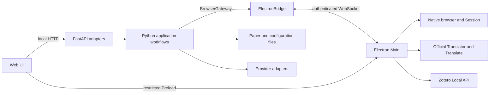

# Architecture

Allfold is one desktop product: an Electron host, a Python application and a Web UI. Electron owns startup and shutdown; Python is not an independently supported Web service.

## Runtime data flow

Main starts one Python process. The HTTP origin remains loopback-only on port 18767; one authenticated WebSocket carries native operations, progress and Solver submessages. Remote pages have no Node or host IPC capabilities.

## Ownership

| Source | Responsibility |
| --- | --- |
| `frontend/ui/` | Workspace, Run, Journals, Kept and Settings UI, source assets and notices |
| `src/allfold/application/` | Use cases, guarded operations and process-local workflow coordination |
| `src/allfold/providers/` | Provider retrieval, queries and source-specific formats |
| `src/allfold/persistence/` | Paper/Markdown projection, safe file operations, Registry and local state |
| `src/allfold/integrations/` | Python-side Zotero, credential and Pydoll adapters |
| `src/allfold/web/` | HTTP projection, validation, composition and Electron WebSocket transport |
| `src/allfold/http_client.py` | Shared synchronous Python HTTP client, proxy parsing, bypass rules and per-request transport routing; independent of Chromium Session |
| `electron/src/main.cjs` | Application lifecycle, trusted IPC and native dispatch |
| `electron/src/browser/` | Native pages, main-window presentation, document identity, navigation and shared Session |
| `electron/src/auth/` | Task-scoped institution authentication and credentials |
| `electron/src/workflows/` | Prepare, Covers and WoS native page operations |
| `electron/src/zotero/` | Official translation sandbox, Local API persistence and host document/HTTP adapters |
| `electron/src/preload/`, `native-ui/` | Restricted capabilities and local native-window UI |

Models, configuration definitions, identifiers and query primitives remain shared Python modules. Application code does not depend on Web adapters; its BrowserGateway describes the existing connected/execute/cancel interface. ElectronBridge adapts it to transport. A pending Future preserves the distinction between cancellation and an already-started save reaching a terminal result.

Journal lookup and remote fallback belong to the application layer; persistence only reads the local Registry. WoS export parsing continues to reuse safe file-reading helpers.

FastAPI composes these implementations. ImportTarget belongs to the application so workflow identity checks do not depend on HTTP forms. Provider normalization uses shared identifiers rather than application workflow helpers.

## Browser Service associations

Python snapshots the saved Journals and Access Services for each invocation. The browser bridge carries an opaque hash of the canonical configuration path, the configuration revision and User State revision alongside the saved Service ID. Import matches saved ISSN/eISSN identifiers with the existing Workspace rules: every matching Journal must select the same nonempty Service; otherwise the Paper remains unassigned. These are invocation snapshots of SQLite state, never a second authoritative mapping. Preparation and subsequent Import dispatches verify the original snapshot, while WoS retains its existing configuration and Workspace checks. Detected changes stop further work without migrating it to a new mapping. Already-dispatched native saves still settle through the existing result protocol.

Kept binds All Services or one saved Service ID to the signed Import target and
one-time workflow authorization. The complete Workspace identity scan runs before
filtering the dispatch plan. Prepare, waiting, Continue and Import retain that
same scope even if the displayed Service filter changes. Queue statistics read
saved associations, while completed batch results retain execution-time Service
and Paper identities independently of later Journal mapping edits. Confirmed
parent saves and attachment-stage diagnostics remain separate from PDF evidence.

The signed Kept target also captures one Zotero Server ID, Library and optional
Collection before Prepare. The configuration's default is a preference for the
next execution, never Desktop's currently selected Collection. Electron stores
Local API authorization separately with protected storage and checks the pinned
instance. Native Local API writes have no automatic replay. Each parent and
attachment has a preallocated native key; per-object create responses and the
complete file upload protocol determine the known result. Browser Session GETs
download Translator PDFs first; an on-demand Python OpenAlex lookup supplies
up to four direct-PDF fallback candidates using existing provider credentials.
OpenAlex queries use the Python HTTP client; fallback PDF GETs use Browser
Session without the publisher referrer or any Zotero authorization.

Last Import belongs to the process-local batch result. Exact-key parent and
children reads provide Item/PDF/Fallback indicators; PDF success additionally
requires confirmed upload registration from that execution. Read errors remain
unknown. Keys and PDF source do not enter Paper frontmatter or a new persistent
verification store. Service attribution comes from the fixed plan. These checks
do not request file paths, read saved PDFs or monitor later user deletions.

BrowserRuntime keeps one current association per physical page, including the workflow/task/request, role, optional Paper/DOI and source page. `pageAssociation(pageId)` returns descriptive metadata with an explicit active flag; `servicePages(scopeId, serviceId)` filters existing pages without creating them. Task completion clears live ownership while retaining the page's last association for inspection. Destruction removes its association and live source/opener references; renderer exit invalidates the association. Reviewed diagnostic events capture the last association before invalidation. They do not restore live associations or change Session, page recycling or closure behavior.

## History and diagnostics

Python coordinators publish bounded business history independently of their
Workspace result snapshots. The unified Run exposes selected-source counts, statistics, issues and retrieval observations through `RunFacts`; its Integrated snapshot uses v6. Old Integrated v4/v5 reads return unsupported and require a new Run, without migration or Reset. Legacy WoS snapshots remain untouched and are not reconstructed into unified results. Electron and Python write separately owned, rotating
JSONL under a common configuration scope and startup runtime ID. Explicit workflow,
task and request identities link native observations with coordinator-confirmed
results. Page association snapshots are descriptive evidence, never browser or
credential authority. A versioned data-only schema validates producer events and
independently filters exports; neither arbitrary log messages nor raw exceptions
enter this store.

The Web adapter exposes recent history, local diagnostic ZIP export and guarded
Logs Reset. Reset coordinates the native writer, preserves existing Workspace
safety checks and marks surviving history when Workspace is reset. See
[logging](logging.md) for storage limits, field meanings and evidence boundaries.

Prepare's CARSI Portal is shared and unassigned; resource and observed target pages carry the saved Service, and popups inherit their attributable source. Query and Export validate that the original prepared page still has the expected scoped Service/revisions, in addition to the existing document checks. Import replaces the reused ImportPage's association for each Paper, including an explicit unassigned Service. Covers and Enrich remain temporary auxiliary pages. Generic Manual Service URL opening retains its existing behavior.

`bindTaskPage` and explicit `navigate(..., {tab})` control task targets. `select` presents a page in the main-window Browser pane; task navigation and WoS handoff do not select tabs. Background creation does not select even the first page, open Browser or focus a webpage. New task pages remain available for explicit manual login or inspection through the existing tabs. Service associations confer no document, task or institution-credential authority. Page/frame identity, task signals, navigation recovery and native-save settlement remain separate checks.

## Configuration editing

One configuration controller owns the saved revisions and ordinary drafts across
Run, Journals, Kept and Settings. A shared scheduler serializes safe field patches;
responses acknowledge the submitted snapshot without replacing later edits.
Server-side admission coordinates writes with task starts, retaining the existing
Compare-and-Write and Workspace lock protections. Active tasks continue using
their saved snapshots while edits remain Pending. A new task requires successful
save and validation; a failed or conflicting draft cannot become task authority.
Provider secrets, CARSI credentials and high-impact operations use explicit
submission rather than ordinary autosave. CARSI mutations settle through the
authenticated native bridge and compare encrypted-store revisions.

## Workbench and task presentation

The main Window contains Chrome, a flexible Workbench Content region and Status.
Its business workspaces are Workspace, Workflows, Journals and Settings.
Workflows keeps Login, Discover and Import to Zotero under one navigation entry.
Browser, Search and History are shared header tools. Quick Open reads the current
local Paper, Journal, saved Service and native tab projections, dispatching each
selection to its owning controller. A `>` prefix searches the command registry.
Browser fills Workbench Content while the business surface retains its state.
The address toolbar and left navigation rail occupy trusted DOM space outside
the native webpage rectangle.

ARRAY, Workflows, Journals and Settings share a presentation-only Navigation Rail,
overlay Index/Directory flyout, Content and Functional Sidebar/Tool Rail. Their
mounted hosts retain expansion and compute docked/overlay geometry from actual
container bounds; targets and measured widths stay separate. Business Controllers
own selection, drafts and shared Reader lifecycle. See [workspace layout](workspace-layout.md)
for size constraints, preference behavior and acceptance boundaries.

BrowserRuntime owns physical pages, task associations and their shared Session. Browser Presentation owns attaching, showing, hiding, sizing and explicitly focusing a selected WebContentsView on the main window. The trusted renderer reports its measured webpage body in CSS pixels through a restricted, sequenced IPC. Main converts with the host's actual Zoom Factor to Electron logical pixels, independently of display DPR, and validates sender, main frame, command, Page ID and rectangle against the host content bounds. Hiding Browser or suspending it for a trusted dialog does not destroy pages or cancel operations. Fullscreen task surfaces can be suspended for explicit Browser interaction and resumed without restarting their player or changing task state.

One Tabs flyout groups Page IDs under CARSI, a scoped saved Service, or Other.
A Service group is keyed by scope ID and saved Service ID; saved names supply
labels. Unassigned and shared pages use explicit roles and recorded provenance.
The directory uses the shared layout controller for flyout size, focus and scroll.
Grouping grants no task, document or authentication authority.

Archive availability and fullscreen task presentation are local UI preferences, outside YAML Save and business SQLite. Archive defaults disabled while its existing resources and layout preference remain available. Legacy Paper links resolve against the current ARRAY candidate/kept collection or report a missing Paper. Run and Kept keep one business coordinator each: polling, workflow identity/generation, Continue/Cancel permissions, terminal acknowledgement, result writes and refresh do not depend on a visual player. The presentation choice is captured at start or restore; changing the preference does not restart work. Inline mode allows safe workspace navigation and does not force a page change at completion.

## Resources and third-party code

The UI build copies sources and generates Kept bundles into Python's ignored static delivery tree. Runtime URLs and API endpoints do not depend on the editable source directory.

Electron package metadata and scripts remain at the package root. `src/shared/paths.cjs` resolves project, native UI, Preload, vendor-notice and Runtime locations. Official Zotero checkouts stay pristine in ignored vendor directories; the Runtime assembler is their only production assembly path. Project adaptations stay in host sources. See [third-party sources](third-party.md).

## Data ownership

Local YAML owns monitor settings. The private `.allfold/user-data.sqlite` owns Journals, Groups, Labels, direct Access Services and default Service assignments, isolated by the canonical configuration path. Existing valid `list.md` files seed each configuration once; subsequent Markdown edits do not change saved user state. Migration validates the complete managed data, records its source and digest, and leaves the original file intact. Paper Markdown owns UUID, primary DOI and direct reliable namespaced identifiers, workflow status and human content. [Paper identity](paper-identity.md) defines the create-only canonicalization, source/version metadata and partial date evidence contract.

The private `.allfold/resources.sqlite` shares complete GOKB snapshots and the CARSI official Catalog across configurations. It holds external evidence, not users' Service preferences. Refresh commits only validated, complete data and retains the previous cache on failure. The Journal Resolver follows Journal → GOKB Platform → CARSI Resource, retaining multiple identities and products. Only a unique, reliable candidate can fill an empty default; saved user choices take precedence. Ordinary Run never requires GOKB.

Both databases live outside Workspace. Within the application project, configurations in subdirectories use the same application data directory; their canonical paths still identify separate user scopes. Registry remains read-only during normal use and retains source-specific evidence. Browser tasks and coordinators are transient, while Zotero owns its Library and attachments. Generated UI and Runtime are rebuildable resources, not user data.

[Safety](safety.md) states the cross-module invariants. Types, parsers and validators in code define fields and interfaces; [development](development.md) defines preparation and verification. Historical plans and investigations are not current implementation authority.

## Discovery and completion boundaries

Provider adapters emit operation-local `ProviderWorkEvidence`; canonicalization groups
explicit strong identities and selects missing metadata in a fixed order.
One Integrated Run overlaps selected PubMed/WoS/OpenAlex journal Discovery under the parent slot and workflow identity. PubMed batches ESearch History/EFetch; OpenAlex merges native source-ISSN filters. Verified pages/native export batches stream DOI targets to shared exact Work lookup. Provider clients share operation-local capability caches, in-flight full Work details and host pacing. A bounded producer/consumer queue coalesces DOI inputs while sources remain active, then drains the final short batch after every producer settles. Work lookup responses enrich discovered roots and never add Discovery candidates. Formal PubMed identity remains separate from a merged Work’s potentially preprint PMID. The Browser worker retains the same captured configuration/Workspace/cancellation authority and never writes a separate Run snapshot or History result.

After Discovery and Work lookup settle, Run deduplicates and excludes saved Papers including Rejected. Batched PubMed article-ID lookup resolves missing direct formal PMIDs. The shared completion engine adds metadata, date and relationship evidence, follows known native preprint targets and gives exhausted transient requests one additional attempt in final settlement. Bound versions contribute date evidence and provenance. Direct formal records supply ordinary metadata and persisted identity. Run uses fixed PubMed, OpenAlex, Europe PMC, Crossref, arXiv, bioRxiv and medRxiv helpers independently of the selected Discovery sources. Only then does one protected create chain run.
Native publication-date filters determine its range; subsequent evidence never
rejudges inclusion. Commit rechecks captured configuration, source revision,
Workspace/Papers identity and the complete identity index before atomic creates.
Existing Paper matches remain byte-identical. Paper Markdown is the only persisted
literature object; standalone Evidence, aliases and version relationships have no
persistent store. Only direct reliable identifiers group Run records and establish
saved ownership. Old Paper identity fields explicitly block safe indexing/writes;
old files are preserved until a user chooses a backed-up Workspace Reset.

The Info preprint lookup coordinator binds to one saved Paper and verifies both
native bioRxiv/medRxiv publication and version responses. It shares Run/workflow
admission without browser authority. Network work holds no Workspace write
lock. The guarded commit checks the exact Paper, configuration, Workspace and
cancellation before appending verified preprint dates and sources and filling an
empty First public. The lookup keeps its result and request cache within the
operation.

First public requires established earliest linked preprint evidence. Typed
journal events remain a separate date collection. Webpage Enrich can fill a
missing Received or Accepted for a journal Candidate independently of Abstract,
Authors and publication date. The month-to-day publication date upgrade still
applies. After a matching official Web Translator returns a journal article,
the Allfold Adapter reads the same source document's manuscript history into
separate date candidates. Missing events can trigger up to 30 seconds of
cancellable snapshots of that same document, bounded by the Browser task.
Each native candidate carries its event kind, ISO date at source precision,
original label, document URL and target DOI. Python verifies the candidate
against the response source before converting it to journal `EvidenceDate`.
DOI Content Negotiation can supply ordinary metadata. Each event can be saved
on its own, and a response without new evidence leaves the Paper unchanged.
The DOI, document, revision and cancellation checks apply before saving.
WoS retains its independent browser lifecycle while sharing the Paper model.
